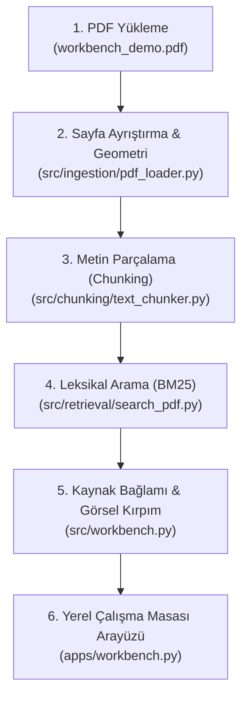

# HybridDoc AI: Mimari Rehber ve Veri Akışı

Bu rehber, projenin mevcut çekirdek mimarisini, veri akışını ve çalışan kodun mantığını adım adım açıklar. Proje, harici yapay zekâ modellerine körü körüne güvenmek yerine **şeffaf, doğrulanabilir ve kaynak kanıtına dayalı (grounded)** bir doküman zekâsı altyapısı sunar.

---

## 1. Uçtan Uca Veri Akışı

Sistem, yüklenen bir PDF belgesini satır satır ayrıştırmaktan kullanıcı arayüzünde görsel kanıt sunmaya kadar şu veri yolunu izler:



---

## 2. Modüller ve Görev Dağılımı

### A. Doküman Ayrıştırma (`src/ingestion/pdf_loader.py` & `formula_loader.py`)
- **`load_pdf(path)`:** PyMuPDF (`fitz`) kütüphanesini kullanarak sayfaları açar ve dijital metin katmanını (`page.get_text("text")`) okur.
- **Gerçek Veri Örneği (`workbench_demo.pdf`, Sayfa 1):**
  ```python
  {
      "page_number": 1,
      "text": "HybridDoc local workbench demo\nPrivacy\nUploaded files stay on your computer.\nNo cloud services, model downloads or automatic OCR are used.\nNative extraction cannot read scanned image text.\nEND OF DEMO PAGE ONE",
      "char_count": 209,
      "file_name": "workbench_demo.pdf",
      "total_pages": 2
  }
  ```
- **`load_pdf_formulas(path)`:** Sayfadaki sözcük ve karakter koordinatlarını (`bbox`) analiz ederek matematiksel blokları tespit eder. Çıkarılan adaylar matematiksel kesinlik taşımaz ve güvenlik gerekçesiyle `answer_eligible=False` olarak etiketlenir.

### B. Metin Parçalama (`src/chunking/text_chunker.py`)
- **`chunk_pages(..., boundary="word")`:** Sayfaları maksimum karakter bütçesi (`max_chars=1000`) ve hedef örtüşme (`overlap=100`) ile parçalara böler.
- **Karakter Bütçesi ve Sözcük Sınırı:**
  - `max_chars` bir kelime veya token sayısı değil, Python `len()` karakter sınırıdır.
  - `boundary="word"` modu, kelimeleri ortasından bölmez; boşluk (`whitespace`) karakterlerini izler.
  - Kesintisiz aşırı uzun dizelerde güvenli karakter kesme devreye girer; metin kaybı yaşanmaz.
- **Formül Duyarlılığı (`chunk_formula_pages`):** Formül blokları atomiktir; örtüşme (overlap) bir formülü ikiye bölemez.

### C. Leksikal Arama (`src/retrieval/search_pdf.py`)
- **`BM25Searcher`:** Harici kütüphane veya model gerektirmeyen deterministik Okapi BM25 algoritmasıdır (`k1=1.5`, `b=0.75`).
- **Normalizasyon:** Türkçe `İ/ı/I` harflerini doğru eşleştirir. Eşleşmeyen sorgularda (ör. `quasar`) boş liste döner; varsayım üretmez.
- **Gerçek Arama Sonucu (`"source passages"` sorgusu):**
  ```python
  {
      "rank": 1,
      "score": 4.0310,
      "chunk_id": "chunk-10",
      "source_order": 10,
      "page_number": 2,
      "excerpt": "Source passages are exact quotes from the document.",
      "detection_status": "native_heuristic_incomplete",
      "answer_eligible": False
  }
  ```

### D. Bağlam Genişletme ve Görsel Kırpım (`src/workbench.py`)
- **`WorkbenchDocument.search()`:** BM25 eşleşmesinin koordinatlarını (`bbox`) alır ve sayfa genişliğinde dikey bir bant (48–160 pt) tanımlar:
  `band = Rect(page.rect.x0, center - height / 2, page.rect.x1, center + height / 2)`
- **Gerçek `source_context` Verisi:**
  ```python
  {
      "text": "Keyword search\n\nSource passages are exact quotes from the document.\n...",
      "bbox": [0.0, 52.68, 595.0, 141.99],
      "association": "not_inferred",
      "note": "Bu kesit çevredeki satır ve sütunları gösterir; etiket–değer ilişkisi otomatik seçilmez."
  }
  ```
- **Kesit metadatası:** Kaynak bandıyla örtüşen mevcut formül kayıtları ve bu
  formülleri içeren gruplar, güven bayrakları değiştirilmeden sonuçta korunur.
  Noktalama, sözcük sayısı, konum veya native blok üyeliği sıradan metni
  otomatik olarak üretime uygun yapmaz. `not_inferred` kanıt için kullanıcı
  tam pasajın kaynak kullanımını ya da ayrı etiket–değer ilişkisini onaylar.
  Tek span, sarılmış paragraf ve karışık font metni tam pasaj olarak
  onaylanabilir; özgün span’ler ve tam kesit korunur.
- **`source_crop()`:** İlgili koordinat bandını PyMuPDF ile piksel görüntüsüne (`pixmap`) dönüştürür.
- **İlişkilendirme:** `src/field_evidence.py` yalnızca native yatay tek satırdaki
  açık `Etiket: Değer` ilişkisini `association: "explicit_same_row"` olarak kaydeder.
  `field_relation` özgün span’leri/kutuları ve tam etiket/değer alıntısını korur;
  kaynak SHA ve sayfa değişmez. Yinelenen etiket, boş değer, yarışan sütun veya
  sarılmış etiket veya algılanan hücre sınırını aşan eşleşme gibi durumlar
  `not_inferred` kalır. Ayrı span’deki iki nokta da yinelenen etikete sayılır. Bu ilişki anlamsal doğruluk,
  kimlik veya formül güveni sağlamaz; `answer_eligible=false` korunur.

### E. Yerel Çalışma Masası (`apps/workbench.py`)
- Streamlit tabanlı arayüz; oturum izolasyonu (`tempfile`), kaynak kartları, tam sayfa metni, parça inceleme ve formül HTML raporunu sunar.

---

## 3. Temel Mimari Kavramlar

### Koordinat Geometrisi vs. Düz Sayfa Metni
PDF belgeleri paragraflardan oluşan Word dokümanları değildir; iki boyutlu bir koordinat düzlemine (`x0, y0, x1, y1`) basılmış bağımsız metin parçacıklarıdır (`span`).

```text
Görsel Düzen (Kullanıcının gördüğü):
[x=35, y=110] Baba Adı:             [x=185, y=110] Orhan Örnek

Ham PDF Akışı (PDF motorunun çizim sırası):
"Öğrenci Adı: \n Baba Adı: \n Deniz Örnek \n Orhan Örnek"
```

- **Etiket ve Değer Ayrımı:** PDF dosyasında çizim sırası sütun sütun yapılabilir. Ham metin akışında `Baba Adı` etiketinin hemen ardından `Deniz Örnek` gelebilir.
- **Çözüm:** Sistem çizim sırasından veya yalnızca yakınlıktan değer seçmez.
  Eşleşmenin dikey koordinat bandını (`source_context`) ve özgün sayfa kırpımını
  (`source_crop`) gösterir. Tek yatay satırdaki açık iki nokta ilişkisi ayrıca
  kaydedilebilir; belirsiz düzenler `not_inferred` kalır. Cevap paneli uygun
  kaynakları varsayılan seçer, dışlanan her kaynağı gerekçesiyle görünür tutar.
  Alan alıntısı etiketi ve değeri birlikte kapsamak zorundadır.
- **Kullanıcı kaynak onayı:** Cevap paneli seçili belirsiz sıradan kaynağın
  tam metnini ve özgün kırpımını gösterir. Kullanıcı iki ayrı onaydan birini
  seçer: **Tam pasajı kaynak olarak kullan** tek span/sarılmış paragraf için
  etiket uydurmadan kaynak kullanımını onaylar; **Etiket–değer ilişkisi**
  mevcut native parçalar arasından iki ayrı seçim ve açık ilişki onayı ister.
  `user_confirmation.kind` sırasıyla `passage` veya `relation` olur. Pasaj
  onayı bir alan ilişkisini doğrulamaz. Her ikisi belge SHA’sı, soru özeti ve
  seçili ham kanıt parmak izine bağlı kullanıcı beyanıdır; `not_inferred`,
  span/kutular ve formül güveni değişmez. Onaylı kaynak tam kesit alıntısı
  gerektirir. Seçim/soru/belge/onay türü veya ilişki seçimi değişikliği onayı
  ve cevabı geçersizleştirir. Onay çağrı yapmaz; üretim ve bulut onayı ayrıdır.

### Sıralama Skoru (Ranking) vs. Cevap Doğruluğu (Correctness)
- BM25 skoru (ör. `4.0310`), sorudaki terimlerin belgedeki sıklığını ve uzunluğunu ölçen leksikal bir sıralama metriğidir.
- Yüksek skor, bilginin sorunun cevabı olduğunu veya doğruluğunu kanıtlamaz; sadece eşleşen pasajı işaret eder.
- `answer_eligible=false` bayrağı, arama sonucunun doğrudan "cevap" olarak kabul edilmesini engeller.

---

## 4. Uygulamalı Laboratuvar (Hands-on Lab)

Tüm komutları repo kök dizininde `.venv/bin/python` ile çalıştırabilirsiniz:

### Adım 1: Sayfa Metnini ve Metaverisini İnceleme
```bash
.venv/bin/python -m src.ingestion.pdf_loader sample_docs/workbench_demo.pdf
```
*Beklenen Çıktı:* Toplam 2 sayfa okunur, 1. sayfanın 209 karakterlik metni ve dijital metin durumu terminalde listelenir.

### Adım 2: Sözcük Sınırlarıyla Parçalama (Chunking)
```bash
.venv/bin/python -m src.chunking.text_chunker sample_docs/workbench_demo.pdf --boundary word --inspect
```
*Beklenen Çıktı:* Kelimeleri bölmeden üretilen 2 adet parça (`Chunk 1` ve `Chunk 2`), sayfa numaraları ve tam metin sınırlarıyla görüntülenir.

### Adım 3: BM25 ile Kaynak Arama
```bash
.venv/bin/python -m src.retrieval.search_pdf sample_docs/workbench_demo.pdf "source passages" --boundary word
```
*Beklenen Çıktı:* Sayfa 2'de 1 eşleşme (Skor: 4.0310), alıntı metni ve `answer_eligible: False` güvenlik uyarısı listelenir.

### Adım 4: Eşleşmeyen Sorgu (Negatif Kontrol)
```bash
.venv/bin/python -m src.retrieval.search_pdf sample_docs/workbench_demo.pdf "quasar"
```
*Beklenen Çıktı:* Eşleşen kaynak bulunamadığı açıkça bildirilir (`No matching source found...`); varsayımsal içerik üretilmez.

### Adım 5: Python API ile Kaynak Bağlamı ve BBox İnceleme
```bash
.venv/bin/python -c "from src.workbench import open_upload; doc = open_upload('workbench_demo.pdf', open('sample_docs/workbench_demo.pdf', 'rb').read()); res = doc.search('source passages')[0]; print('BBox:', res['source_context']['bbox']); print('Association:', res['source_context']['association'])"
```
*Beklenen Çıktı:* BBox `[0.0, 52.68, 595.0, 141.99]` ve `Association: not_inferred` değerleri görüntülenir.

### Adım 6: Yerel Çalışma Masası Arayüzünü Başlatma
```bash
.venv/bin/python -m streamlit run apps/workbench.py --server.address 127.0.0.1 --server.port 8501 --server.maxUploadSize 20 --browser.gatherUsageStats false --client.toolbarMode minimal
```
*Beklenen Çıktı:* Tarayıcınızda `http://127.0.0.1:8501` adresinde çalışan, internet veya API anahtarı gerektirmeyen yerel arayüz açılır.

---

## 5. Mevcut Yetenek Sınırları ve Yol Haritası

- **Formül Doğrulaması:** Matematiksel semboller ve eksi işaretleri taranmış veya dijital PDF'lerde kolayca bozulabilir. OCR adayları henüz kesin doğruluk garantisi vermediği için matematik cevapları daima doğrulanmamış (`answer_eligible=false`) kabul edilir.
- **Model Destekli Üretim (LLM):** İsteğe bağlı cevap yolunun kurulumu, sağlayıcıları ve güven sınırları için [cevap üretimi kılavuzuna](grounded-answers.md) bakın.
- **Vektör Veritabanları ve Embeddings:** Anlamsal benzerlik araması (Dense Retrieval / Chroma / Sentence Transformers) isteğe bağlı mimari alternatiflerdir; hafif yerel arama ve RAG temeli için zorunlu değildir.
